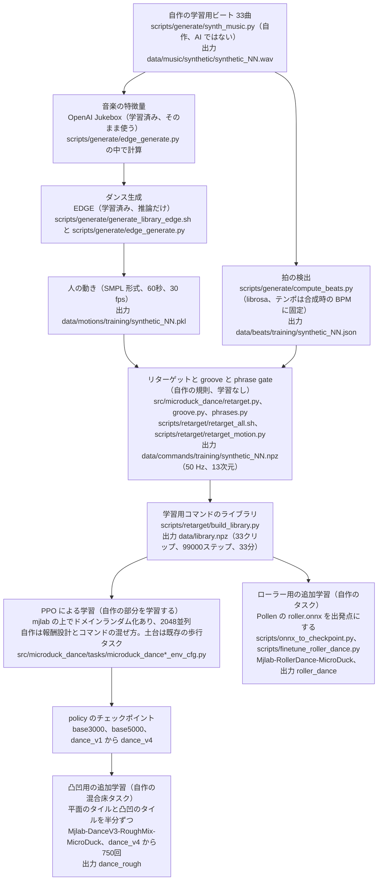
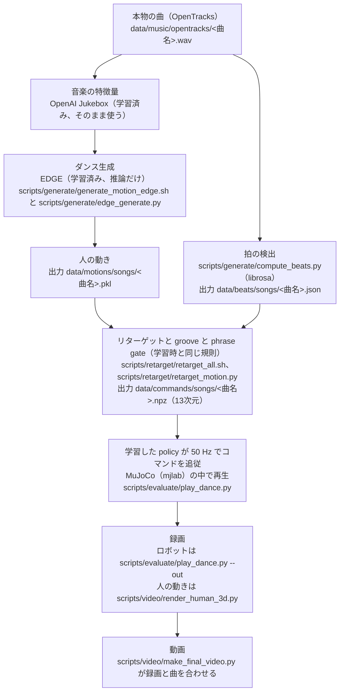

# microduck が曲に合わせて踊る（Physical AI 応用1講座 最終課題）

曲を1つ与えると、MuJoCo シミュレータの中で microduck（Pollen Robotics の小型二足ロボット、14関節、腕なし）がその曲に合わせて踊る。このリポジトリで自作したのはそのための一連の仕組みである。

1. 曲から人のダンスを生成する。学習済みの生成モデル EDGE を推論だけに使う。
2. 生成した人の動きを、microduck の13次元コマンドに変換する（リターゲット）。拍に合わせた動き（groove）もここで足す。groove は人の動きに無い動きなので、Task 19 から振幅を半分にした。曲の区切りごとに「その場で踊る」と「歩く」を切り替える規則（phrase gate）は、人が止まらない区間でロボットを止めていたので、既定では使わない（`--phrase-gate 1` で戻せる）。
3. そのコマンドを転ばずに追従する強化学習の policy を、自分で学習する。平らな床の dance_v4 のほかに、凸凹の地面用の dance_rough と、ローラースケート用の roller_dance を学習した。
4. policy でコマンドを再生して録画し、曲を重ねて動画にする。

コマンドは policy に与える13個の目標値で、並びは `[vx, vy, wz | neck_pitch, head_pitch, head_yaw, head_roll | body_x, body_y, body_z, body_roll, body_pitch, body_yaw]` である。最初の3つが足運び（前後と左右の速度、旋回の角速度）、次の4つが頭の関節角、最後の6つが胴体の姿勢を表す。制御は 50 Hz で動く。

## microduck とは

microduck は Pollen Robotics が作った小型の二足ロボットである。高さは約25 cm、重さは約800 g で、14個のサーボ（Dynamixel XL330）で動く。関節は脚が片側5つずつで10、首と頭が4で、腕はない。この課題では実機を使わず、MuJoCo のシミュレーションの中だけで動かした。3Dメッシュは Pollen Robotics のもので、ライセンスは CC BY-NC-SA 4.0 である。

結果の数値と経緯は提出した説明資料（PDF）にある。実験記録とレポートの原稿（`dance/docs/`）は git に入れていない。この README の括弧の中の実験 ID（fid001 など）は、その実験記録の節の名前である。データの出どころは [data/CREDITS.md](data/CREDITS.md) にある。

## 本物の曲と自作の学習用ビート

曲は2種類あり、置き場所を分けてある。

| 種類 | 置き場所 | 中身 | 使い道 |
|---|---|---|---|
| 本物の曲 | `data/music/opentracks/` | OpenTracks（旧 DOVA-SYNDROME）の5曲。動画に使うのは swag、funky_magic、fallin_for_you | 推論だけ（動画で踊らせる曲） |
| 自作の学習用ビート | `data/music/synthetic/` | `scripts/generate/synth_music.py` が numpy で合成した33曲（`synthetic_00.wav` から `synthetic_32.wav`） | 学習用コマンドの材料 |

OpenTracks の規約は曲を AI の学習に使うことを禁止している（禁止事項11）。そのため本物の曲は学習の経路に一度も入らない。学習に使うコマンドはすべて自作のビートから作った。どちらの曲ファイルも git には入っていない。

## AI の流れ

### 学習時



同じ流れを文章で書く。

1. 自作の学習用ビートを作る。`scripts/generate/synth_music.py` が numpy で33曲を合成する（AI ではない）。出力は `data/music/synthetic/synthetic_NN.wav`。
2. 拍を検出する。`scripts/generate/compute_beats.py` が librosa で拍の時刻を求める。テンポは合成時の BPM に固定する。出力は `data/beats/training/synthetic_NN.json`。
3. 音楽の特徴量を作る。OpenAI Jukebox（学習済み、そのまま使う）の中間層の出力を、EDGE の入力にする。計算は `scripts/generate/edge_generate.py` の中で行う。
4. 人のダンスを生成する。EDGE（学習済み、推論だけ）が特徴量から人の動きを作る。スクリプトは `scripts/generate/generate_library_edge.sh` と `scripts/generate/edge_generate.py`。出力は `data/motions/training/synthetic_NN.pkl`。
5. 人の動きをロボットのコマンドに変換する。自作の規則で、学習はしない。リターゲット（`src/microduck_dance/retarget.py`）、拍に合わせた頷きや沈み込み（`groove.py`）、曲の区切りごとの切り替え（`phrases.py`）を通す。スクリプトは `scripts/retarget/retarget_all.sh`。出力は `data/commands/training/synthetic_NN.npz`（50 Hz、13次元）。既定の設定は次のとおり（Task 19、実験記録の fid001）。phrase gate は使わない。groove は振幅0.5倍（`--groove-scale`）。頭と胴体の列は 0.12 秒先行させる（`--posture-lead-s`、ロボットが人より 0.10〜0.16 秒遅れる分を打ち消す。groove は自分の先行 0.14 秒を持つので重ねない）。wz は人の向きに追従する heading servo で作る（`--heading-servo`）。Task 15 の設定は `RetargetConfig(**TASK15_OPTIONS)` で再現でき、dance_v4 が学習したコマンドとビット単位で一致する。
6. コマンドをつなげてライブラリにする。`scripts/retarget/build_library.py` が33クリップを1つにまとめる。出力は `data/library.npz`。
7. policy を学習する。mjlab の上で PPO を使い、ドメインランダム化をかけて 2048 並列で学習する。自作したのは報酬設計とコマンドの混ぜ方で、土台は既存の歩行タスク `Mjlab-Velocity-Flat-MicroDuck` である。
8. 出力は policy のチェックポイント（base3000、base5000、dance_v1 から dance_v4）。
9. 凸凹の地面用に、dance_v4 を自作の混合床タスク `Mjlab-DanceV3-RoughMix-MicroDuck` で750回追加学習した（dance_rough）。床のタイルの半分は平面、残りの半分は上流の凸凹のタイル（中央の台を 0.5 m 角にしたもの）である。凸凹のタイルだけで学習すると平らな床での旋回が崩れたので、両方を混ぜた（実験記録の rough002、rough004、video003）。
10. ローラースケート用に、Pollen Robotics の roller.onnx（Apache-2.0、改変して使用）を rsl_rl の重みに戻し（`scripts/onnx_to_checkpoint.py`）、自作のタスク `Mjlab-RollerDance-MicroDuck` で追加学習した（`scripts/finetune_roller_dance.py`、roller_dance）。足運びのコマンドは `dance_rollers.map_dance_twist` で蹴る強さ、ブレーキ、向きの目標に変換する（roller001、roller002）。
11. ボールの上で踊るタスク `Mjlab-BallDance-MicroDuck` も b11 から学習した（ball003）。ボールから落ちず頭の追従は良くなったが、踊りに見えないので動画には使っていない。

本物の曲（OpenTracks）はこの経路に一度も入らない。

### 推論時



同じ流れを文章で書く。

1. 本物の曲を入力する。`data/music/opentracks/<曲名>.wav`。
2. 拍を検出する。`scripts/generate/compute_beats.py`（librosa）。出力は `data/beats/songs/<曲名>.json`。
3. 音楽の特徴量を作る。OpenAI Jukebox（学習済み、そのまま使う）。
4. 人のダンスを生成する。EDGE（学習済み、推論だけ）。スクリプトは `scripts/generate/generate_motion_edge.sh` と `scripts/generate/edge_generate.py`。出力は `data/motions/songs/<曲名>.pkl`。
5. 学習時と同じ規則でコマンドに変換する。`scripts/retarget/retarget_all.sh`。出力は `data/commands/songs/<曲名>.npz`（13次元）。
6. 学習した policy が、MuJoCo（mjlab）の中で 50 Hz でコマンドを追従する。動画では平らな床で dance_v4、凸凹で dance_rough、ローラースケートで roller_dance を使った。平らな床と凸凹は `scripts/evaluate/play_dance.py`（凸凹は `--terrain video`）、ローラーは `scripts/evaluate/roller_dance_eval.py`。
7. 録画する。ロボットは `scripts/evaluate/play_dance.py --out`、人の動きは `scripts/video/render_human_3d.py`。
8. `scripts/video/make_final_video.py` が録画と曲を合わせて動画にする。

### どこが AI で、どこを自分で学習したか

| 部分 | AI か | 学習 | 由来 |
|---|---|---|---|
| OpenAI Jukebox（音楽の特徴量） | AI | 学習済みをそのまま使う | 外部（OpenAI） |
| EDGE（音楽からダンスを生成） | AI | 学習済みをそのまま使う（推論だけ） | 外部（Stanford、AIST++ で学習） |
| librosa の拍検出 | 信号処理（AI ではない） | なし | 外部ライブラリ |
| 学習用ビートの合成 | AI ではない | なし | 自作 |
| リターゲット、groove、phrase gate | AI ではない（手で決めた規則） | なし | 自作 |
| ダンス用の policy（dance_v1 から dance_v4、dance_rough） | AI | PPO で自分で学習した | 自作（土台のタスクは既存） |
| ローラーのダンスの policy roller_dance | AI | roller.onnx から PPO で追加学習した | 出発点は外部（Pollen Robotics、Apache-2.0）、追加学習は自分 |
| 歩行の policy（base3000、base5000） | AI | 既存の歩行タスクで自分で学習した | タスクは既存、学習は自分 |
| ロボットのモデル、ドメインランダム化、PPO の実装 | | | 既存（microduck-playground、mjlab、rsl_rl） |
| ボール上の policy b11 | AI | 学習済みを取得 | 外部（HannesVonEssen/microduck-basketball） |

学習した policy は次のとおり。dance_rough と roller_dance 以外は 2048 並列の PPO で、数字は通算の反復回数である。

| policy | タスク | 開始点 | 反復回数 | 学習に使ったコマンド |
|---|---|---|---|---|
| base3000 | 歩行 `Mjlab-Velocity-Flat-MicroDuck` | ゼロから | 3000 | 既存の歩行コマンド |
| base5000（比較の基準） | 歩行 | base3000 | 5000 | 既存の歩行コマンド |
| dance_v1 | `Mjlab-Dance-Flat-MicroDuck` | base3000 | 5000 | 滑らかな乱数軌道（ライブラリなし） |
| dance_v2 | `Mjlab-DanceLib-Flat-MicroDuck` | dance_v1 | 6500 | FlowerDance で作った当時のライブラリ |
| dance_v3 | `Mjlab-DanceV3-Flat-MicroDuck` | base5000 | 8000 | FlowerDance で作った当時のライブラリ |
| dance_v4（動画の平らな床） | `Mjlab-DanceV3-Flat-MicroDuck` | dance_v3 | 10000 | var001 のライブラリ（EDGE、Task 15 の規則。今の `data/library.npz` とは違う） |
| dance_rough（動画の凸凹） | `Mjlab-DanceV3-RoughMix-MicroDuck` | dance_v4 | 10750（4096並列） | 今の `data/library.npz` |
| roller_dance（動画のローラー） | `Mjlab-RollerDance-MicroDuck` | roller.onnx | 3400（4096並列、roller.onnx から数える） | 今の `data/library.npz` と、1.5〜4秒続く蹴りとブレーキの区間 |

dance_v4 が学習したのは var001 のライブラリ（コマンドの配列の SHA-256 は 9690021b...1de0a8）で、fid001 で規則を変える前のものである。今の `data/library.npz`（57e74da0...0197）とは違う。var001 のライブラリは手順5のコマンドで作り直せる。dance_v2 と dance_v3 は FlowerDance で作ったライブラリで学習した。FlowerDance にはライセンスが無いので、そのライブラリはこのリポジトリに入れていない。dance_v1 はライブラリを使わないが、学習した後に Dance タスクの報酬を変えた（ref001）。そのため dance_v1 から dance_v3 は、このリポジトリからは当時と同じ条件で学習し直せない。転倒の回数などの結果は 実験記録の eval001、eval002、eval003 にある。

## このリポジトリとサブモジュール

元のプロジェクト microduck-playground（https://github.com/Vottivott/microduck-playground）は `third_party/microduck-playground` に git のサブモジュールとして入れてあり、commit f010ef1 に固定している。サブモジュールの中は何も変更していない。自作の部分はすべてこのリポジトリの直下にある。

| 場所 | どちらか | 内容 |
|---|---|---|
| `third_party/microduck-playground/src/mjlab_microduck/robot/`、`actuator/`、`tasks/mdp.py` ほか | サブモジュール（既存） | 機体モデル、アクチュエータモデル、ドメインランダム化を含むタスク基盤 |
| `third_party/microduck-playground/src/mjlab_microduck/tasks/microduck_velocity_env_cfg.py` | サブモジュール（既存） | 歩行タスク。ダンスのタスクはこれを土台にしている |
| `third_party/microduck-playground/src/mjlab_microduck/tasks/microduck_basketball_env_cfg.py` | サブモジュール（既存） | ボール上でバランスを取るタスク。ball dance の土台 |
| `third_party/microduck-playground/src/mjlab_microduck/tasks/microduck_velocity_rollers_env_cfg.py` | サブモジュール（既存） | ローラー付きの機体モデルと元の報酬。roller_dance の土台 |
| `src/microduck_dance/` | このリポジトリ（自作） | コマンドの範囲、リターゲット、groove、phrase gate、学習用の軌道とクリップ再生、コマンドファイルの読み書き、EDGE 出力の床の補正、見える動きの統計 |
| `src/microduck_dance/tasks/dance_commands.py`、`dance_v3.py` | このリポジトリ（自作） | 毎ステップ値が変わるコマンド項と、ダンス用の報酬 |
| `src/microduck_dance/tasks/microduck_dance_env_cfg.py`、`microduck_dance_v3_env_cfg.py` | このリポジトリ（自作） | ダンスのタスク（Dance、DanceLib、DanceV3、凸凹の Rough と、平面と凸凹を混ぜた床の RoughMix）。凸凹のタイルの生成は既存 |
| `src/microduck_dance/tasks/microduck_ball_dance_env_cfg.py` | このリポジトリ（自作） | ボールの上で踊るタスク `Mjlab-BallDance-MicroDuck` |
| `src/microduck_dance/tasks/dance_rollers.py`、`microduck_roller_dance_env_cfg.py` | このリポジトリ（自作） | ローラーのダンスのタスク `Mjlab-RollerDance-MicroDuck`（コマンドの変換と報酬） |
| `src/microduck_dance/tasks/__init__.py` | このリポジトリ（自作） | ダンスのタスクを mjlab に登録する（下の「タスクの登録」） |
| `src/microduck_dance/basketball_finetune.py`、`scripts/finetune_basketball.py` | このリポジトリ（上流のファイルから派生） | b11 を ball dance のタスクで継続学習する。上流の同名のファイル（commit f010ef1、Apache-2.0）を元にし、変更点を各ファイルの冒頭に書いた |
| `scripts/onnx_to_checkpoint.py`、`scripts/finetune_roller_dance.py` | このリポジトリ（自作） | roller.onnx を rsl_rl の重みに戻すスクリプトと、roller_dance の追加学習 |
| `scripts/measure_ball_stance.py`、`scripts/check_ball_dance_step0.py` | このリポジトリ（自作） | ボール上の立ち姿勢の計測と、ball dance の継続学習の最初の1歩の確認 |
| `scripts/fetch_basketball.sh`、`scripts/fetch_pollen_policies.sh` | このリポジトリ（自作） | 外部の学習済み policy を取ってくる |
| roller.onnx | 外部（Pollen Robotics、Apache-2.0） | roller_dance の出発点。重みを追加学習で変えた。git には入れない |
| `dance/scripts/` | このリポジトリ（自作） | EDGE の導入と生成、拍の検出、リターゲット、学習用ビートとライブラリ、再生と評価と録画、人の動きの描画、動画の組み立て |
| `dance/data/` | このリポジトリ（生成物） | 生成した人の動き、コマンド、拍、学習用ライブラリ、曲の出典。曲ファイルは含めない |
| `dance/docs/` | git に入れない | 実験記録、レポートの原稿と図。内容は提出した説明資料（PDF）にまとめた |
| `tests/` | このリポジトリ（自作） | 上記のテスト。上流のテストはサブモジュールの `tests/` にある |

### タスクの登録

mjlab は import されたときに、entry point `mjlab.tasks` に登録されたパッケージをすべて import する。このリポジトリの `pyproject.toml` は `microduck_dance.tasks` をそこに登録しているので、`uv run train`、`uv run play`、`uv run list-envs` で上流のタスクと並んでダンスのタスクが使える。

```bash
uv run list-envs | grep -i dance
uv run train Mjlab-DanceV3-Flat-MicroDuck --env.scene.num-envs 64 --agent.max-iterations 5
```

タスクの id、観測、報酬、runner の設定は、元の fork（上流のファイルを直接変えていた版）と同じである。`tests/test_cfg_snapshot.py` が、元の fork で書き出した cfg のスナップショットと比べて確かめる。

### 上流を変更しないで済ませた点

元の fork は上流の9ファイルを変えていた。このリポジトリでは次のようにして、サブモジュールを変えずに済ませた。パッチは要らなかった。

- `src/mjlab_microduck/tasks/__init__.py` のタスク登録は `src/microduck_dance/tasks/__init__.py` に移し、上の entry point で読み込む。
- `microduck_velocity_env_cfg.py`、`microduck_sitstand_env_cfg.py`、`microduck_standup_env_cfg.py`、`microduck_ground_pick_env_cfg.py` では、凸凹の地形の cfg（`MICRODUCK_ROUGH_TERRAINS_CFG`）を factory ごとに deepcopy するように変えていた。上流のままだと、import 時に作る play 用の cfg が共有のオブジェクトに 5 x 5 の格子を書き込む。このリポジトリでは、ダンスの cfg の factory（`microduck_dance_env_cfg.py` の `rough_terrains_cfg`）がモジュールの定義どおりの cfg を作り直して、その copy を使う。ダンスの凸凹の学習は元の fork と同じ 10 x 20 の格子で走る。上流の歩行などの凸凹のタスクは、上流のまま（5 x 5 の格子）になる。
- `basketball_finetune.py` と `finetune_basketball.py` の変更は、上の表の派生ファイルにした。上流のファイルはサブモジュールの中にそのまま残る。
- `README.md` と `.gitignore` の変更は、このリポジトリの `README.md` と `.gitignore` に移した。

## 再現手順

### 0. 環境を作る

コマンドはリポジトリの直下で実行する。上流のプロジェクトはサブモジュールなので、clone のときに一緒に取ってくる。Python のパッケージは uv で入れる（Python 3.12、`pyproject.toml` と `uv.lock`）。`uv sync` はサブモジュールの `mjlab_microduck` を editable で入れ、このリポジトリの `microduck_dance` も入れる。

```bash
git clone --recurse-submodules https://github.com/tomomimu12345/microduck-dance
cd microduck-dance
# --recurse-submodules を付けずに clone したときは: git submodule update --init
uv sync
```

`uv sync` はリポジトリの `.venv` に仮想環境を作る。別の場所に置くときは `UV_PROJECT_ENVIRONMENT=<場所>` を付けて `uv sync` と `uv run` を実行する。シェルスクリプト（`retarget_all.sh`、`rough_eval.sh`、`rough_record.sh`、`fall_eval.sh`、`sweep_vel_gain.sh`）は環境変数 `MICRODUCK_PY` の Python を使い、既定は `.venv/bin/python` である。EDGE の生成スクリプトは `EDGE_PY`（既定 `$HOME/.venvs/edge/bin/python`、手順3の `setup_edge.sh` が作る）を使う。

学習と評価には CUDA の GPU が要る。テスト（`uv run pytest`）、リターゲット、`rough_metrics.py` は CPU で動く。EDGE の導入には、ディスク約 13 GB、実行時に空きメモリ 16 GB、VRAM 8 GB の GPU が要る（`setup_edge.sh` の冒頭）。録画には `MUJOCO_GL=egl` が要る。

外部の学習済み policy は git に入れていない。次のスクリプトで、決めたコミットのファイルを取ってきて SHA-256 を確かめる。

```bash
# Pollen の roller.onnx と芸の policy（pollen-robotics/microduck-policies、commit 665ae4eb、Apache-2.0）
#   -> logs/tricks/pollen-microduck-policies/{roller,roulade,alpha_sitstand,velstand}.onnx
bash scripts/fetch_pollen_policies.sh
# ボール上の b11（HannesVonEssen/microduck-basketball、Apache-2.0）-> logs/rsl_rl/basketball/b11_6999/checkpoint.pt
bash scripts/fetch_basketball.sh
```

URL、コミット、SHA-256 は `data/CREDITS.md` と各スクリプトの冒頭にある。roller.onnx の SHA-256 は cf05651d2708a2f9364212e86b866c97a70ace8131c492500105e8f28bf99afd である。

学習のログとチェックポイントはリポジトリの直下の `logs/rsl_rl/` に、評価と録画の出力は `out/` に書かれる。どちらも git には入らない。

### 1. 曲を用意する

曲ファイルは git に入っていない。`dance/data/CREDITS.md` の曲ページから mp3 を入手し、先頭60秒を 44.1 kHz ステレオの wav にして `dance/data/music/opentracks/<曲名>.wav` に置く（末尾は1.5秒のフェードアウト）。

学習用ビートは次で作り直せる。

```bash
python3 dance/scripts/generate/synth_music.py --out dance/data/music/synthetic --n 33
```

### 2. 拍を検出する

```bash
~/.venvs/edge/bin/python dance/scripts/generate/compute_beats.py dance/data/music/opentracks/*.wav --out-dir dance/data/beats/songs
~/.venvs/edge/bin/python dance/scripts/generate/compute_beats.py dance/data/music/synthetic/*.wav --synth-seed0 1000 --out-dir dance/data/beats/training
```

librosa が入っていれば別の Python でもよい。拍の json は git に入っている。

### 3. EDGE でダンスを生成する

EDGE、Jukebox、jukemirlib はリポジトリの外に入れる。重みは再配布しない。

```bash
bash dance/scripts/setup/setup_edge.sh
bash dance/scripts/generate/generate_motion_edge.sh dance/data/music/opentracks/swag.wav dance/data/motions/songs/swag.pkl 0
bash dance/scripts/generate/generate_library_edge.sh
```

曲ごとに使ったシードは swag 0、funky_magic 0、fallin_for_you 1、redwing_beats 0、pastel_house 0 である（実験記録の gen002）。生成済みの pkl は `dance/data/motions/` に入っているので、この手順は省略できる。

### 4. コマンドに変換してライブラリを作る

```bash
bash dance/scripts/retarget/retarget_all.sh
```

曲の pkl から `dance/data/commands/songs/<曲名>.npz` を、学習用の pkl から `dance/data/commands/training/synthetic_NN.npz` を作り、最後に `dance/data/library.npz` を作り直す。`library.npz` は git に入っている。

### 5. policy を学習する

```bash
# base3000: 歩行タスクを最初から3000回
uv run train Mjlab-Velocity-Flat-MicroDuck --env.scene.num-envs 2048 --agent.max-iterations 3000

# base5000（比較の基準）: base3000 から歩行タスクのまま2000回
uv run train Mjlab-Velocity-Flat-MicroDuck --env.scene.num-envs 2048 --agent.max-iterations 2000 \
    --agent.resume True --agent.load-run <base3000の実行名> --agent.load-checkpoint model_2999.pt

# dance_v3: base5000 から DanceV3 のタスクで3000回
#   先に base5000 の model_4998.pt を logs/rsl_rl/dance_v3/base5000_init/ にコピーしておく
uv run train Mjlab-DanceV3-Flat-MicroDuck --env.scene.num-envs 2048 --agent.max-iterations 3000 \
    --agent.resume True --agent.load-run base5000_init --agent.load-checkpoint model_4998.pt

# dance_v4（動画に採用）: dance_v3 から同じタスクで2000回。学習したのは var001 のライブラリなので、先に作り直す
uv run train Mjlab-DanceV3-Flat-MicroDuck --env.scene.num-envs 2048 --agent.max-iterations 2000 \
    --agent.resume True --agent.load-run <dance_v3の実行名> --agent.load-checkpoint model_7997.pt
```

タスクは `dance/data/library.npz` を読む。dance_v4 を学習する前に、var001 のライブラリをその場所に作り直す。fid001 の `TASK15_OPTIONS`（`src/microduck_dance/retarget.py`）と同じ設定を `retarget_motion.py` のフラグで与える。CPU で約40秒かかる。

```bash
py=.venv/bin/python
mkdir -p out/lib_var001
for pkl in dance/data/motions/training/*.pkl; do
    stem=$(basename "$pkl" .pkl)
    $py dance/scripts/retarget/retarget_motion.py "$pkl" out/lib_var001/$stem.npz \
        --beats dance/data/beats/training/$stem.json \
        --phrase-gate 1 --groove-scale 1 --posture-lead-s 0 --heading-servo 0 --vel-gain 1.3
done
$py dance/scripts/retarget/build_library.py out/lib_var001/synthetic_*.npz --out dance/data/library.npz
# コマンドの配列の SHA-256 が 9690021b4a7d4b083ff2e51f901b80884f3c9c282a9e38c85563ca620f1de0a8 になる
PYTHONPATH=src $py -c "import hashlib, numpy as np; from microduck_dance.command_file import load_command_file as f; \
c = f('dance/data/library.npz')[0]; print(hashlib.sha256(np.ascontiguousarray(c, np.float32).tobytes()).hexdigest())"
# dance_v4 の学習が終わったら、今のライブラリに戻す
git checkout dance/data/library.npz
```

2026-10-24 にこの手順で作り直し、SHA-256 が一致することを確かめた（実験記録の pub001）。ただし dance_v4 の出発点の dance_v3 は FlowerDance のライブラリで学習したので、このリポジトリからは作れない（上の表の下の段落）。dance_v3 の段も var001 のライブラリで学習すれば同じ手順を最後まで辿れるが、当時の dance_v4 とは違う policy になる。

dance_v1 と dance_v2 の学習手順は 実験記録の eval001 にある。

dance_rough と roller_dance は Colab の A100 で 4096 並列で学習した。

```bash
# dance_rough: dance_v4 の model_9996.pt を logs/rsl_rl/dance_v3_rough_mix/init_v4/ にコピーしてから、混合床で追加学習
#   755回で 9996 から 10750 まで回り、最後に model_10750.pt を保存する（今の library.npz を使う）
uv run train Mjlab-DanceV3-RoughMix-MicroDuck --env.scene.num-envs 4096 --agent.max-iterations 755 \
    --agent.resume True --agent.load-run init_v4 --agent.load-checkpoint model_9996.pt
#   使ったのは logs/rsl_rl/dance_v3_rough_mix/2026-10-23_17-51-43_rough004/model_10750.pt（元の実行は11067まで回して止めた）
```

roller_dance は、roller.onnx を actor に戻してから3段で追加学習した。`--stage` で段ごとの設定（蹴りの区間を混ぜる割合、wheel_speed の重み、ブレーキの報酬の std と重み）を選ぶ。どの段も今の `library.npz` を使う。

| 段 | `--stage` | 蹴りの区間 | wheel_speed の重み | ブレーキの std / 重み | 反復 |
|---|---|---|---|---|---|
| roller001 | `roller001` | なし | 10 | 0.3 / 1 | 0〜1699（critic のウォームアップ 200 を含む） |
| roller002 の1段目 | `roller002_stage1` | 4割 | 20 | 0.3 / 1 | 1700〜2999（rewarm 50 を含む） |
| roller002 の2段目 | `roller002_stage2`（既定） | 4割 | 20 | 0.1 / 2 | 3000〜3399（rewarm 30 を含む） |

```bash
# roller.onnx（手順0の fetch_pollen_policies.sh）を rsl_rl の actor に戻す
uv run scripts/onnx_to_checkpoint.py logs/tricks/pollen-microduck-policies/roller.onnx \
    logs/rsl_rl/roller_dance/roller_onnx_init/actor.pt --std 0.25
# roller001: critic を200回温めてから1500回
uv run scripts/finetune_roller_dance.py --init logs/rsl_rl/roller_dance/roller_onnx_init/actor.pt \
    --stage roller001 --run-name roller001 --num-envs 4096 --warmup-iterations 200 --iterations 1500
# roller002 の1段目: roller001 の model_1699.pt から、critic を50回温めてから1250回
uv run scripts/finetune_roller_dance.py --resume <roller001の実行>/model_1699.pt \
    --stage roller002_stage1 --run-name roller002 --num-envs 4096 --rewarm-iterations 50 --iterations 1250
# roller002 の2段目: 1段目の model_2999.pt から、critic を30回温めてから370回
uv run scripts/finetune_roller_dance.py --resume <roller002の実行>/model_2999.pt \
    --stage roller002_stage2 --run-name roller002b --num-envs 4096 --rewarm-iterations 30 --iterations 370
#   使ったのは logs/rsl_rl/roller_dance/2026-10-23_18-50-41_roller002b/model_3399.pt
```

各段の結果は 実験記録の roller001 と roller002 にある。

### 6. 評価、録画、動画の組み立て

下の例は swag の場合である。3曲（swag、funky_magic、fallin_for_you）について同じことをする。`make_final_video.py` はファイル名で入力を探すので、名前はこのとおりにする。

```bash
# 評価（学習時のランダム化あり、3シード x 16環境、60秒）。dance_v4 と base5000 の両方
uv run python dance/scripts/evaluate/play_dance.py --checkpoint <dance_v4のmodel_9996.pt> \
    --commands dance/data/commands/songs/swag.npz --eval --seeds 0 1 2 --num-envs 16 --json out/eval_v4/dance_v4_swag.json
uv run python dance/scripts/evaluate/play_dance.py --checkpoint <base5000のmodel_4998.pt> \
    --commands dance/data/commands/songs/swag.npz --eval --seeds 0 1 2 --num-envs 16 --json out/eval_v4/base5000_swag.json

# 録画（ランダム化なし、1環境、曲の頭から全部）。base5000 の録画は比較の曲（fallin_for_you）だけ要る
MUJOCO_GL=egl uv run python dance/scripts/evaluate/play_dance.py --checkpoint <dance_v4のmodel_9996.pt> \
    --commands dance/data/commands/songs/swag.npz --cam-follow lagged --out out/rec_v4/swag_v4.mp4
MUJOCO_GL=egl uv run python dance/scripts/evaluate/play_dance.py --checkpoint <base5000のmodel_4998.pt> \
    --commands dance/data/commands/songs/fallin_for_you.npz --cam-follow lagged --out out/rec_v4/fallin_for_you_base5000.mp4

# 人の動きの3D表示
MUJOCO_GL=egl uv run python dance/scripts/video/render_human_3d.py --motion dance/data/motions/songs/swag.pkl \
    --out out/rec_v4/swag_human3d.mp4

# 凸凹の区間のクリップ（dance_rough、Funky Magic の 0〜15 秒、最も難しい階段のタイル、最初の2秒は引きの画）
MUJOCO_GL=egl uv run python dance/scripts/evaluate/play_dance.py --checkpoint <dance_roughのmodel_10750.pt> \
    --commands dance/data/commands/songs/funky_magic.npz --terrain video --tile-type pyramid_stairs --spawn-u 0.125 \
    --cam-follow lagged --cam-distance 0.8 --cam-elevation -30 --cam-azimuth 135 --wide-intro-s 2 \
    --max-seconds 15 --out out/rough/t31/funky_magic_video_15s_wideintro_rough.mp4

# ローラーの区間のクリップ（roller_dance、Funky Magic の 28〜43 秒）
MUJOCO_GL=egl uv run python dance/scripts/evaluate/roller_dance_eval.py --checkpoint <roller_danceのmodel_3399.pt> \
    --commands dance/data/commands/songs/funky_magic.npz --start-seconds 28 --max-seconds 15 \
    --cam-distance 0.9 --cam-elevation -20 --out out/roller/video2/roller002_funky_magic_15s.mp4

# 提出用の動画。既定の引数が提出した動画の設定（比較は Fallin For You の 20 秒から25秒）
MUJOCO_GL=egl uv run python dance/scripts/video/make_final_video.py --out out/final/microduck_dance.mp4
```

講座のオープニングとエンディングの映像（`out/course_assets/op.mp4`、`ed.mp4`）は講座から配られた素材で、このリポジトリには入っていない。`make_final_video.py` は、入力のファイルが無い区間を警告を出して飛ばす。新しい clone でもオープニングとエンディングを除いた動画は組み立てられる。`--list-sections` で区間の一覧、`--table-only` で区間の表だけを出す。

テストは `uv run pytest` で走る（CPU、このリポジトリの `tests/`）。上流のテストはサブモジュールの中で `uv run pytest third_party/microduck-playground/tests` で走る。

## 凸凹の地面（rough terrain）

最初は、平らな床で学習した dance_v4 をそのまま凸凹の地面で踊らせた（rough001）。地面は歩行タスクの rough と同じもので、タイルごとに平らな箱、段差（1段の高さ最大 1.5 cm）、ランダムな格子（高さ ±1 cm 以内）、ゆるい坂のどれかになる。policy は地面を見ていない（高さの観測がない）。タスク名は `Mjlab-DanceV3-Rough-MicroDuck`。転倒は少なかったが、体の向きの追従が大きく落ちた。

床の平面を1枚の箱に置き換えると平らな床でも同じだけ落ちたので、原因は足と箱の接触だった（rough002）。凸凹のタイルだけで追加学習すると平らな床での旋回が崩れたので、平面のタイルと凸凹のタイルを半分ずつ並べた床 `Mjlab-DanceV3-RoughMix-MicroDuck` で750回追加学習した（rough004）。これが dance_rough で、動画の凸凹の区間だけに使う。

動画の凸凹（学習用の段差と格子を最大の難しさで並べたもの）での比較は次のとおり（DR あり、3シード x 16環境、60秒、3曲、video003）。

| policy | 床 | 転倒（1分あたり） | 人との向きの相関 |
|---|---|---|---|
| dance_v4 | 動画の凸凹 | 2.81 ± 0.29 | 0.525 |
| dance_rough | 動画の凸凹 | 1.26 ± 0.14 | 0.575 |
| dance_v4 | 平らな床 | 0.111 ± 0.018 | 0.875 |
| dance_rough | 平らな床 | 0.090 ± 0.025 | 0.842 |

向きの相関は、各環境の最初の転倒までの区間で測り、その区間が20秒に満たない環境は除いた。採点できた環境は144のうち、動画の凸凹で dance_v4 が76、dance_rough が95、平らな床で142と140である（pub001）。dance_v4 は凸凹でよく転ぶので、凸凹の2行は区間の長さも環境の集合も違う比較である。平らな床では dance_v4 の方が向きの相関が高いので、平らな床の区間は dance_v4 のままにした。地形の4種類の図は `scripts/evaluate/terrain_figure.py` で作れる（既定の出力先 `docs/figures/` は git に入れていない）。

```bash
# 動画の凸凹での転倒の評価
uv run python dance/scripts/evaluate/play_dance.py --checkpoint <model.pt> --terrain video \
    --commands dance/data/commands/songs/swag.npz --eval --seeds 0 1 2 --num-envs 16 --dump-eval --json out/rough/swag.json
# 人との向きの相関（--dump-eval の npz から）
uv run python dance/scripts/evaluate/rough_metrics.py out/rough/swag.npz --json out/rough/metrics.json
# 最初の評価（rough001）の転倒と、段差の上の録画
bash dance/scripts/evaluate/rough_eval.sh flat rough
bash dance/scripts/evaluate/rough_record.sh dumps video
```

## ローラースケート

Pollen Robotics の roller.onnx から追加学習した roller_dance で踊らせた。足運びのコマンドは蹴る強さ、ブレーキ、向きの目標に変換し、横の速度は使わない。結果（DR あり、3シード x 16環境、60秒、3曲の範囲、roller002）は、移動量が1分あたり 6.05〜7.14 m（roller.onnx は 2.30〜3.38 m）、頭の RMSE が 0.103〜0.121（roller.onnx は 0.317〜0.363）。代わりに旋回とコマンドの相関は 0.43〜0.62 に下がった（roller.onnx は 0.83〜0.89）。

```bash
# 評価（roller.onnx を比べるときは actor.pt と --zero-pose-obs --action-scale 0.8）
uv run dance/scripts/evaluate/roller_dance_eval.py --checkpoint <model_3399.pt> \
    --commands dance/data/commands/songs/funky_magic.npz --eval --seeds 0 1 2 --num-envs 16 --json out/roller/funky_magic.json
# 録画（動画は Funky Magic の 28 秒から15秒。make_final_video.py が読む名前）
MUJOCO_GL=egl uv run dance/scripts/evaluate/roller_dance_eval.py --checkpoint <model_3399.pt> \
    --commands dance/data/commands/songs/funky_magic.npz --start-seconds 28 --max-seconds 15 \
    --cam-distance 0.9 --cam-elevation -20 --out out/roller/video2/roller002_funky_magic_15s.mp4
```

## 権利と出典

詳しい出典と規約の確認結果は [data/CREDITS.md](data/CREDITS.md) にある。要点は次のとおり。

- 曲は OpenTracks（旧 DOVA-SYNDROME）の "Swag" by Phalene、"Funky Magic" by FLASH☆BEAT、"Fallin For You" by Flehmann。予備に "Redwing Beats" by Anonyment と "パステルハウス" by かずち。曲ファイルはリポジトリに含めない。AI の学習には使っていない。
- ダンス生成は EDGE（J. Tseng, R. Castellon, C. K. Liu, CVPR 2023、MIT、commit 17c3428）。推論だけに使い、チェックポイントは再配布しない。
- 音楽の特徴量は OpenAI Jukebox（P. Dhariwal et al., 2020、OpenAI Noncommercial Use License）を jukemirlib（MIT）経由で使った。生成したダンスは OpenAI の Jukebox を使って作ったものである。
- EDGE の学習データは AIST++（R. Li, S. Yang, D. A. Ross, A. Kanazawa, ICCV 2021、アノテーションは CC BY 4.0）で、その元は AIST Dance Video Database（S. Tsuchida et al., ISMIR 2019）である。
- 機体モデル、タスク基盤、歩行タスクは microduck-playground（Apache-2.0）のもので、元は pollen-robotics/microduck_rl（Apache-2.0）である。
- Microduck の3Dメッシュは Pollen Robotics のもので、CC BY-NC-SA 4.0（https://creativecommons.org/licenses/by-nc-sa/4.0/ 、出典 https://github.com/pollen-robotics/microduck_rl の `LICENSE-MODELS.md`）。メッシュのファイルはサブモジュールの中にあり、変更していない。
- シミュレーションと学習は mjlab、MuJoCo、MuJoCo Warp（Apache-2.0）と rsl_rl（BSD-3-Clause）。
- ボール上の policy b11 は HannesVonEssen/microduck-basketball（Apache-2.0、2026-10-24 に Hugging Face のモデルカード、LICENSE、NOTICE で確認）。ball dance の追加学習で重みを変えた。元のファイルも変えた重みも git には入れていない。
- ローラーの roller_dance は、Pollen Robotics の roller.onnx（pollen-robotics/microduck-policies、commit 665ae4eb、Apache-2.0）を出発点にして重みを追加学習で変えたもの（改変して使用）。元のファイルも変えた重みも git には入れていない。再配布するときは Apache-2.0 の本文、変更した旨、出典を付ける。
- 以前の実験では FlowerDance（XulongT/FlowerDance、FineDance で学習）を使った。ライセンスが無いため、FlowerDance を呼ぶスクリプトと FlowerDance で作ったファイルは公開リポジトリに入れていない。

生成したダンス（`dance/data/motions/` の pkl）と、そこから作ったファイル（`dance/data/commands/`、`dance/data/library.npz`）は、このリポジトリの Apache-2.0 の対象外である。EDGE（MIT）で OpenAI Jukebox の特徴量（OpenAI Noncommercial Use License）を使い、AIST++（CC BY 4.0、元は AIST Dance Video Database）で学習したモデルから作った。商用に使ってはいけない。
