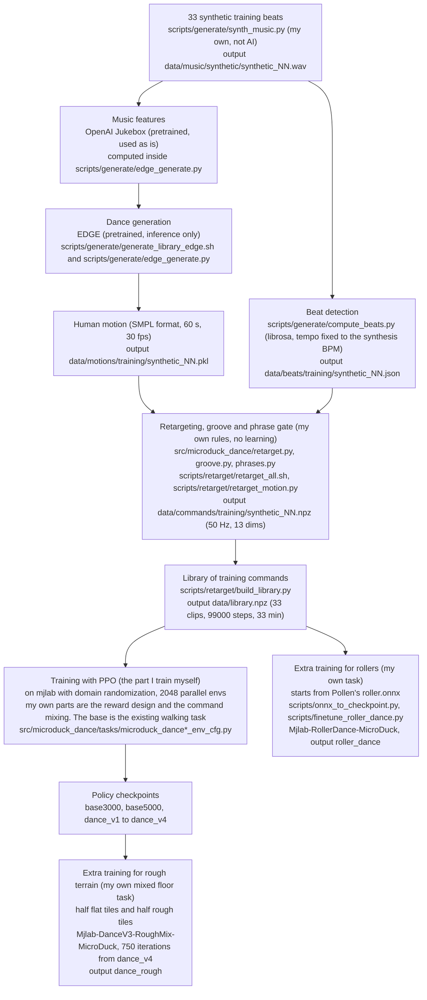
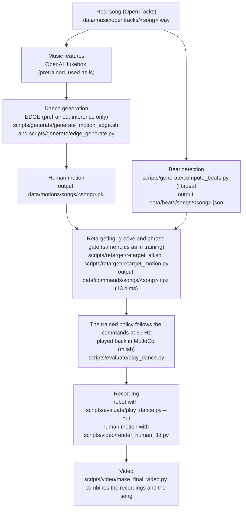

# microduck dances to a song (Physical AI 応用1 final assignment)

English | [日本語](README.ja.md)

Give it a song, and microduck (a small bipedal robot by Pollen Robotics, 14 joints, no arms) dances to it in the MuJoCo simulator. This repository contains the pipeline I built for that.

1. Generate a human dance from the song. The pretrained generative model EDGE is used for inference only.
2. Convert the generated human motion into 13-dimensional commands for microduck (retargeting). Beat-synced motion (groove) is also added in this step. Groove is motion that the human dance does not have, so its amplitude was halved from Task 19 on. A rule that switches between "dance in place" and "walk" at each phrase boundary of the song (phrase gate) stopped the robot in parts where the human keeps moving. It is off by default (`--phrase-gate 1` turns it back on).
3. Train my own reinforcement learning policy that follows those commands without falling. Besides dance_v4 for the flat floor, I trained dance_rough for rough terrain and roller_dance for roller skates.
4. Play the commands with the policy, record it, and add the song to make a video.

A command is 13 target values given to the policy, in the order `[vx, vy, wz | neck_pitch, head_pitch, head_yaw, head_roll | body_x, body_y, body_z, body_roll, body_pitch, body_yaw]`. The first 3 are footwork (forward and sideways velocity, and turning rate). The next 4 are the head joint angles. The last 6 are the body pose. Control runs at 50 Hz.

## What microduck is

microduck is a small bipedal robot made by Pollen Robotics. It is about 25 cm tall, weighs about 800 g, and is driven by 14 servos (Dynamixel XL330). It has 10 leg joints (5 per side) and 4 neck and head joints, and no arms. This assignment did not use the real robot. It ran only in MuJoCo simulation. The 3D meshes belong to Pollen Robotics and are licensed under CC BY-NC-SA 4.0.

The result numbers and the history are in the submitted report (PDF). The experiment log and the report drafts (`dance/docs/`) are not in git. Experiment IDs in parentheses in this README (fid001 and so on) are section names in that log. Data sources are listed in [data/CREDITS.md](data/CREDITS.md).

## Real songs and synthetic training beats

There are two kinds of songs, kept in separate places.

| Kind | Location | Contents | Use |
|---|---|---|---|
| Real songs | `data/music/opentracks/` | 5 songs from OpenTracks (formerly DOVA-SYNDROME). The video uses swag, funky_magic and fallin_for_you | Inference only (the songs the robot dances to in the video) |
| Synthetic training beats | `data/music/synthetic/` | 33 tracks synthesized with numpy by `scripts/generate/synth_music.py` (`synthetic_00.wav` to `synthetic_32.wav`) | Source of the training commands |

The OpenTracks terms forbid using the songs for AI training (prohibited item 11). So the real songs never enter the training path. All commands used for training were made from the synthetic beats. Neither kind of song file is in git.

## The AI pipeline

### Training



The same pipeline in words.

1. Make the synthetic training beats. `scripts/generate/synth_music.py` synthesizes 33 tracks with numpy (not AI). The output is `data/music/synthetic/synthetic_NN.wav`.
2. Detect beats. `scripts/generate/compute_beats.py` finds the beat times with librosa. The tempo is fixed to the BPM used in synthesis. The output is `data/beats/training/synthetic_NN.json`.
3. Compute music features. The intermediate layer output of OpenAI Jukebox (pretrained, used as is) becomes the input of EDGE. This is computed inside `scripts/generate/edge_generate.py`.
4. Generate a human dance. EDGE (pretrained, inference only) produces human motion from the features. The scripts are `scripts/generate/generate_library_edge.sh` and `scripts/generate/edge_generate.py`. The output is `data/motions/training/synthetic_NN.pkl`.
5. Convert the human motion into robot commands. These are my own rules, with no learning. The motion goes through retargeting (`src/microduck_dance/retarget.py`), beat-synced nods and dips (`groove.py`) and switching at phrase boundaries (`phrases.py`). The script is `scripts/retarget/retarget_all.sh`. The output is `data/commands/training/synthetic_NN.npz` (50 Hz, 13 dims). The default settings are as follows (Task 19, fid001 in the log). The phrase gate is off. Groove amplitude is 0.5x (`--groove-scale`). The head and body columns are shifted 0.12 s earlier (`--posture-lead-s`). This cancels the 0.10 to 0.16 s lag of the robot behind the human. Groove has its own 0.14 s lead, so the shift is not applied to it. wz comes from a heading servo that follows the human's facing direction (`--heading-servo`). The Task 15 settings can be reproduced with `RetargetConfig(**TASK15_OPTIONS)`, and they match the commands dance_v4 was trained on bit for bit.
6. Join the commands into a library. `scripts/retarget/build_library.py` combines the 33 clips into one. The output is `data/library.npz`.
7. Train the policy. Training uses PPO on mjlab, with domain randomization and 2048 parallel envs. My own parts are the reward design and how commands are mixed. The base is the existing walking task `Mjlab-Velocity-Flat-MicroDuck`.
8. The outputs are policy checkpoints (base3000, base5000, dance_v1 to dance_v4).
9. For rough terrain, dance_v4 got 750 more iterations on my own mixed floor task `Mjlab-DanceV3-RoughMix-MicroDuck` (dance_rough). Half of the floor tiles are flat. The other half are the upstream rough tiles (with the center platform set to 0.5 m square). Training on rough tiles only broke turning on the flat floor, so both kinds were mixed (rough002, rough004 and video003 in the log).
10. For roller skates, Pollen Robotics' roller.onnx (Apache-2.0, used with modifications) was converted back into rsl_rl weights (`scripts/onnx_to_checkpoint.py`) and trained further on my own task `Mjlab-RollerDance-MicroDuck` (`scripts/finetune_roller_dance.py`, roller_dance). `dance_rollers.map_dance_twist` converts the footwork commands into kick strength, brake and heading targets (roller001, roller002).
11. A task for dancing on a ball, `Mjlab-BallDance-MicroDuck`, was also trained from b11 (ball003). The robot stayed on the ball and head tracking improved, but it did not look like dancing, so it is not used in the video.

The real songs (OpenTracks) never enter this path.

### Inference



The same pipeline in words.

1. Input a real song, `data/music/opentracks/<song>.wav`.
2. Detect beats with `scripts/generate/compute_beats.py` (librosa). The output is `data/beats/songs/<song>.json`.
3. Compute music features with OpenAI Jukebox (pretrained, used as is).
4. Generate a human dance with EDGE (pretrained, inference only). The scripts are `scripts/generate/generate_motion_edge.sh` and `scripts/generate/edge_generate.py`. The output is `data/motions/songs/<song>.pkl`.
5. Convert it into commands with the same rules as in training, using `scripts/retarget/retarget_all.sh`. The output is `data/commands/songs/<song>.npz` (13 dims).
6. The trained policy follows the commands at 50 Hz in MuJoCo (mjlab). The video uses dance_v4 on the flat floor, dance_rough on rough terrain and roller_dance on roller skates. Flat floor and rough terrain use `scripts/evaluate/play_dance.py` (rough terrain with `--terrain video`). Rollers use `scripts/evaluate/roller_dance_eval.py`.
7. Record. The robot is recorded with `scripts/evaluate/play_dance.py --out`, and the human motion with `scripts/video/render_human_3d.py`.
8. `scripts/video/make_final_video.py` combines the recordings and the song into a video.

### Which parts are AI, and which parts I trained

| Part | AI or not | Training | Origin |
|---|---|---|---|
| OpenAI Jukebox (music features) | AI | Pretrained, used as is | External (OpenAI) |
| EDGE (dance generation from music) | AI | Pretrained, used as is (inference only) | External (Stanford, trained on AIST++) |
| librosa beat detection | Signal processing (not AI) | None | External library |
| Synthesis of training beats | Not AI | None | My own |
| Retargeting, groove, phrase gate | Not AI (hand-made rules) | None | My own |
| Dance policies (dance_v1 to dance_v4, dance_rough) | AI | Trained by me with PPO | My own (the base task is existing) |
| Roller dance policy roller_dance | AI | Trained further with PPO from roller.onnx | Starting point is external (Pollen Robotics, Apache-2.0), extra training by me |
| Walking policies (base3000, base5000) | AI | Trained by me on the existing walking task | Existing task, trained by me |
| Robot model, domain randomization, PPO implementation | | | Existing (microduck-playground, mjlab, rsl_rl) |
| Ball policy b11 | AI | Downloaded pretrained | External (HannesVonEssen/microduck-basketball) |

The trained policies are listed below. All except dance_rough and roller_dance use PPO with 2048 parallel envs. The numbers are cumulative iteration counts.

| policy | Task | Starting point | Iterations | Commands used for training |
|---|---|---|---|---|
| base3000 | Walking `Mjlab-Velocity-Flat-MicroDuck` | From scratch | 3000 | Existing walking commands |
| base5000 (baseline) | Walking | base3000 | 5000 | Existing walking commands |
| dance_v1 | `Mjlab-Dance-Flat-MicroDuck` | base3000 | 5000 | Smooth random trajectories (no library) |
| dance_v2 | `Mjlab-DanceLib-Flat-MicroDuck` | dance_v1 | 6500 | The library made with FlowerDance at the time |
| dance_v3 | `Mjlab-DanceV3-Flat-MicroDuck` | base5000 | 8000 | The library made with FlowerDance at the time |
| dance_v4 (flat floor in the video) | `Mjlab-DanceV3-Flat-MicroDuck` | dance_v3 | 10000 | The var001 library (EDGE, Task 15 rules. Different from the current `data/library.npz`) |
| dance_rough (rough terrain in the video) | `Mjlab-DanceV3-RoughMix-MicroDuck` | dance_v4 | 10750 (4096 parallel envs) | The current `data/library.npz` |
| roller_dance (rollers in the video) | `Mjlab-RollerDance-MicroDuck` | roller.onnx | 3400 (4096 parallel envs, counted from roller.onnx) | The current `data/library.npz` plus kick and brake segments lasting 1.5 to 4 s |

dance_v4 was trained on the var001 library (SHA-256 of the command array 9690021b...1de0a8), which is from before the rule change in fid001. It is different from the current `data/library.npz` (57e74da0...0197). The var001 library can be rebuilt with the commands in step 5. dance_v2 and dance_v3 were trained on a library made with FlowerDance. FlowerDance has no license, so that library is not in this repository. dance_v1 does not use a library, but the Dance task reward was changed after it was trained (ref001). For these reasons dance_v1 to dance_v3 cannot be retrained from this repository under the same conditions as before. Results such as fall counts are in eval001, eval002 and eval003 in the log.

## This repository and the submodule

The original project microduck-playground (https://github.com/Vottivott/microduck-playground) is included as a git submodule at `third_party/microduck-playground`, pinned to commit f010ef1. Nothing inside the submodule is modified. All of my own code is at the top level of this repository.

| Location | Which | Contents |
|---|---|---|
| `third_party/microduck-playground/src/mjlab_microduck/robot/`, `actuator/`, `tasks/mdp.py` and others | Submodule (existing) | Robot model, actuator model, and the task framework including domain randomization |
| `third_party/microduck-playground/src/mjlab_microduck/tasks/microduck_velocity_env_cfg.py` | Submodule (existing) | Walking task. The dance tasks are built on it |
| `third_party/microduck-playground/src/mjlab_microduck/tasks/microduck_basketball_env_cfg.py` | Submodule (existing) | Task for balancing on a ball. The base of ball dance |
| `third_party/microduck-playground/src/mjlab_microduck/tasks/microduck_velocity_rollers_env_cfg.py` | Submodule (existing) | Robot model with rollers and the original rewards. The base of roller_dance |
| `src/microduck_dance/` | This repository (my own) | Command ranges, retargeting, groove, phrase gate, training trajectories and clip playback, command file I/O, floor correction of EDGE output, statistics of visible motion |
| `src/microduck_dance/tasks/dance_commands.py`, `dance_v3.py` | This repository (my own) | Command terms whose values change every step, and the dance rewards |
| `src/microduck_dance/tasks/microduck_dance_env_cfg.py`, `microduck_dance_v3_env_cfg.py` | This repository (my own) | Dance tasks (Dance, DanceLib, DanceV3, Rough for rough terrain, and RoughMix with a floor that mixes flat and rough). The rough tile generation is existing |
| `src/microduck_dance/tasks/microduck_ball_dance_env_cfg.py` | This repository (my own) | Task for dancing on a ball, `Mjlab-BallDance-MicroDuck` |
| `src/microduck_dance/tasks/dance_rollers.py`, `microduck_roller_dance_env_cfg.py` | This repository (my own) | Roller dance task `Mjlab-RollerDance-MicroDuck` (command conversion and rewards) |
| `src/microduck_dance/tasks/__init__.py` | This repository (my own) | Registers the dance tasks with mjlab (see "Registering the tasks" below) |
| `src/microduck_dance/basketball_finetune.py`, `scripts/finetune_basketball.py` | This repository (derived from upstream files) | Continues training b11 on the ball dance task. Based on the upstream files of the same name (commit f010ef1, Apache-2.0). The changes are listed at the top of each file |
| `scripts/onnx_to_checkpoint.py`, `scripts/finetune_roller_dance.py` | This repository (my own) | A script that converts roller.onnx back into rsl_rl weights, and the extra training of roller_dance |
| `scripts/measure_ball_stance.py`, `scripts/check_ball_dance_step0.py` | This repository (my own) | Measures the standing pose on the ball, and checks the first step of ball dance continued training |
| `scripts/fetch_basketball.sh`, `scripts/fetch_pollen_policies.sh` | This repository (my own) | Download external pretrained policies |
| roller.onnx | External (Pollen Robotics, Apache-2.0) | Starting point of roller_dance. The weights were changed by extra training. Not in git |
| `dance/scripts/` | This repository (my own) | EDGE setup and generation, beat detection, retargeting, training beats and library, playback, evaluation and recording, human motion rendering, video assembly |
| `dance/data/` | This repository (generated) | Generated human motion, commands, beats, training library, song credits. Song files are not included |
| `dance/docs/` | Not in git | Experiment log, report drafts and figures. Their content is summarized in the submitted report (PDF) |
| `tests/` | This repository (my own) | Tests for the above. The upstream tests are in the submodule's `tests/` |

### Registering the tasks

When mjlab is imported, it imports every package registered under the entry point `mjlab.tasks`. The `pyproject.toml` of this repository registers `microduck_dance.tasks` there. So `uv run train`, `uv run play` and `uv run list-envs` show the dance tasks next to the upstream tasks.

```bash
uv run list-envs | grep -i dance
uv run train Mjlab-DanceV3-Flat-MicroDuck --env.scene.num-envs 64 --agent.max-iterations 5
```

The task ids, observations, rewards and runner settings are the same as in the original fork (the version that edited upstream files directly). `tests/test_cfg_snapshot.py` checks this against cfg snapshots written out from the original fork.

### How upstream stays unmodified

The original fork changed 9 upstream files. This repository avoids changing the submodule as follows. No patches were needed.

- Task registration in `src/mjlab_microduck/tasks/__init__.py` moved to `src/microduck_dance/tasks/__init__.py` and is loaded through the entry point above.
- `microduck_velocity_env_cfg.py`, `microduck_sitstand_env_cfg.py`, `microduck_standup_env_cfg.py` and `microduck_ground_pick_env_cfg.py` had been changed to deepcopy the rough terrain cfg (`MICRODUCK_ROUGH_TERRAINS_CFG`) in each factory. In upstream as is, the play cfg built at import time writes a 5 x 5 grid into the shared object. In this repository, the dance cfg factory (`rough_terrains_cfg` in `microduck_dance_env_cfg.py`) rebuilds the cfg as defined in the module and uses that copy. Rough terrain training for dance runs on the same 10 x 20 grid as the original fork. Upstream rough tasks such as walking stay as in upstream (5 x 5 grid).
- The changes to `basketball_finetune.py` and `finetune_basketball.py` became the derived files in the table above. The upstream files stay unchanged inside the submodule.
- The changes to `README.md` and `.gitignore` moved to this repository's `README.md` and `.gitignore`.

## How to reproduce

### 0. Set up the environment

Run commands from the top of the repository. The upstream project is a submodule, so fetch it together when you clone. Python packages are installed with uv (Python 3.12, `pyproject.toml` and `uv.lock`). `uv sync` installs the submodule's `mjlab_microduck` as editable, and also installs this repository's `microduck_dance`.

```bash
git clone --recurse-submodules https://github.com/tomomimu12345/microduck-dance
cd microduck-dance
# If you cloned without --recurse-submodules, run git submodule update --init
uv sync
sudo apt install ffmpeg fonts-ipaexfont   # needed for video assembly and its test (tests/test_dance_video.py)
```

The report PDF (`build_report_pdf.sh`) uses pandoc, lualatex (texlive-lang-japanese) and the Windows fonts Arial and BIZ UDGothic. Fonts are read from `/mnt/c/Windows/Fonts` by default. If they are somewhere else, run it with `FONTDIR=<path>`.

`uv sync` creates a virtual environment in the repository's `.venv`. To put it somewhere else, run `uv sync` and `uv run` with `UV_PROJECT_ENVIRONMENT=<path>`. The shell scripts (`retarget_all.sh`, `rough_eval.sh`, `rough_record.sh`, `fall_eval.sh`, `sweep_vel_gain.sh`) use the Python in the environment variable `MICRODUCK_PY`, which defaults to `.venv/bin/python`. The EDGE generation scripts use `EDGE_PY` (default `$HOME/.venvs/edge/bin/python`, created by `setup_edge.sh` in step 3).

Training and evaluation need a CUDA GPU. The tests (`uv run pytest`), retargeting and `rough_metrics.py` run on CPU. Setting up EDGE needs about 13 GB of disk, 16 GB of free memory at run time, and a GPU with 8 GB of VRAM (see the top of `setup_edge.sh`). Recording needs `MUJOCO_GL=egl`.

External pretrained policies are not in git. The following scripts download the files at fixed commits and check their SHA-256.

```bash
# Pollen's roller.onnx and trick policies (pollen-robotics/microduck-policies, commit 665ae4eb, Apache-2.0)
#   -> logs/tricks/pollen-microduck-policies/{roller,roulade,alpha_sitstand,velstand}.onnx
bash scripts/fetch_pollen_policies.sh
# Ball policy b11 (HannesVonEssen/microduck-basketball, Apache-2.0) -> logs/rsl_rl/basketball/b11_6999/checkpoint.pt
bash scripts/fetch_basketball.sh
```

URLs, commits and SHA-256 values are in `data/CREDITS.md` and at the top of each script. The SHA-256 of roller.onnx is cf05651d2708a2f9364212e86b866c97a70ace8131c492500105e8f28bf99afd.

Training logs and checkpoints go to `logs/rsl_rl/` at the top of the repository, and evaluation and recording outputs go to `out/`. Neither is in git.

### 1. Prepare the songs

Song files are not in git. Get the mp3 files from the song pages in `dance/data/CREDITS.md`. Convert the first 60 seconds to 44.1 kHz stereo wav (with a 1.5 s fade out at the end) and put them at `dance/data/music/opentracks/<song>.wav`.

The training beats can be rebuilt with the following.

```bash
python3 dance/scripts/generate/synth_music.py --out dance/data/music/synthetic --n 33
```

### 2. Detect beats

```bash
~/.venvs/edge/bin/python dance/scripts/generate/compute_beats.py dance/data/music/opentracks/*.wav --out-dir dance/data/beats/songs
~/.venvs/edge/bin/python dance/scripts/generate/compute_beats.py dance/data/music/synthetic/*.wav --synth-seed0 1000 --out-dir dance/data/beats/training
```

Any other Python works if librosa is installed. The beat json files are in git.

### 3. Generate dances with EDGE

EDGE, Jukebox and jukemirlib are installed outside the repository. Their weights are not redistributed.

```bash
bash dance/scripts/setup/setup_edge.sh
bash dance/scripts/generate/generate_motion_edge.sh dance/data/music/opentracks/swag.wav dance/data/motions/songs/swag.pkl 0
bash dance/scripts/generate/generate_library_edge.sh
```

The seeds used per song are swag 0, funky_magic 0, fallin_for_you 1, redwing_beats 0 and pastel_house 0 (gen002 in the log). The generated pkl files are in `dance/data/motions/`, so you can skip this step.

### 4. Convert to commands and build the library

```bash
bash dance/scripts/retarget/retarget_all.sh
```

This makes `dance/data/commands/songs/<song>.npz` from the song pkl files and `dance/data/commands/training/synthetic_NN.npz` from the training pkl files. At the end it rebuilds `dance/data/library.npz`. `library.npz` is in git.

### 5. Train the policies

```bash
# base3000: walking task from scratch for 3000 iterations
uv run train Mjlab-Velocity-Flat-MicroDuck --env.scene.num-envs 2048 --agent.max-iterations 3000

# base5000 (baseline): 2000 more iterations of the walking task from base3000
uv run train Mjlab-Velocity-Flat-MicroDuck --env.scene.num-envs 2048 --agent.max-iterations 2000 \
    --agent.resume True --agent.load-run <base3000 run name> --agent.load-checkpoint model_2999.pt

# dance_v3: 3000 iterations of the DanceV3 task from base5000
#   First copy model_4998.pt of base5000 to logs/rsl_rl/dance_v3/base5000_init/
uv run train Mjlab-DanceV3-Flat-MicroDuck --env.scene.num-envs 2048 --agent.max-iterations 3000 \
    --agent.resume True --agent.load-run base5000_init --agent.load-checkpoint model_4998.pt

# dance_v4 (used in the video): 2000 iterations of the same task from dance_v3. It was trained on the var001 library, so rebuild that first
uv run train Mjlab-DanceV3-Flat-MicroDuck --env.scene.num-envs 2048 --agent.max-iterations 2000 \
    --agent.resume True --agent.load-run <dance_v3 run name> --agent.load-checkpoint model_7997.pt
```

The tasks read `dance/data/library.npz`. Before training dance_v4, rebuild the var001 library at that location. Pass the same settings as `TASK15_OPTIONS` of fid001 (`src/microduck_dance/retarget.py`) as flags to `retarget_motion.py`. It takes about 40 seconds on CPU.

```bash
py=.venv/bin/python
mkdir -p out/lib_var001
for pkl in dance/data/motions/training/*.pkl; do
    stem=$(basename "$pkl" .pkl)
    $py dance/scripts/retarget/retarget_motion.py "$pkl" out/lib_var001/$stem.npz \
        --beats dance/data/beats/training/$stem.json \
        --phrase-gate 1 --groove-scale 1 --posture-lead-s 0 --heading-servo 0 --vel-gain 1.3
done
$py dance/scripts/retarget/build_library.py out/lib_var001/synthetic_*.npz --out dance/data/library.npz
# The SHA-256 of the command array becomes 9690021b4a7d4b083ff2e51f901b80884f3c9c282a9e38c85563ca620f1de0a8
PYTHONPATH=src $py -c "import hashlib, numpy as np; from microduck_dance.command_file import load_command_file as f; \
c = f('dance/data/library.npz')[0]; print(hashlib.sha256(np.ascontiguousarray(c, np.float32).tobytes()).hexdigest())"
# After dance_v4 training finishes, restore the current library
git checkout dance/data/library.npz
```

On 2026-10-24 I rebuilt the library with these steps and confirmed that the SHA-256 matches (pub001 in the log). However, dance_v3, the starting point of dance_v4, was trained on the FlowerDance library, so it cannot be made from this repository (see the paragraph below the table above). If you also train the dance_v3 stage on the var001 library, you can follow the same steps to the end, but you get a different policy from the original dance_v4.

The training steps for dance_v1 and dance_v2 are in eval001 in the log.

dance_rough and roller_dance were trained on a Colab A100 with 4096 parallel envs.

```bash
# dance_rough: copy model_9996.pt of dance_v4 to logs/rsl_rl/dance_v3_rough_mix/init_v4/, then train further on the mixed floor
#   755 iterations run from 9996 to 10750 and save model_10750.pt at the end (uses the current library.npz)
uv run train Mjlab-DanceV3-RoughMix-MicroDuck --env.scene.num-envs 4096 --agent.max-iterations 755 \
    --agent.resume True --agent.load-run init_v4 --agent.load-checkpoint model_9996.pt
#   The one used is logs/rsl_rl/dance_v3_rough_mix/2026-10-23_17-51-43_rough004/model_10750.pt (the original run went to 11067 and was stopped)
```

roller_dance was made by converting roller.onnx back into an actor and then training further in 3 stages. `--stage` selects the settings for each stage (the share of kick segments mixed in, the wheel_speed weight, and the std and weight of the brake reward). Every stage uses the current `library.npz`.

| Stage | `--stage` | Kick segments | wheel_speed weight | Brake std / weight | Iterations |
|---|---|---|---|---|---|
| roller001 | `roller001` | None | 10 | 0.3 / 1 | 0 to 1699 (includes 200 critic warmup) |
| roller002 stage 1 | `roller002_stage1` | 40% | 20 | 0.3 / 1 | 1700 to 2999 (includes 50 rewarm) |
| roller002 stage 2 | `roller002_stage2` (default) | 40% | 20 | 0.1 / 2 | 3000 to 3399 (includes 30 rewarm) |

```bash
# Convert roller.onnx (from fetch_pollen_policies.sh in step 0) back into an rsl_rl actor
uv run scripts/onnx_to_checkpoint.py logs/tricks/pollen-microduck-policies/roller.onnx \
    logs/rsl_rl/roller_dance/roller_onnx_init/actor.pt --std 0.25
# roller001: warm up the critic for 200 iterations, then 1500 iterations
uv run scripts/finetune_roller_dance.py --init logs/rsl_rl/roller_dance/roller_onnx_init/actor.pt \
    --stage roller001 --run-name roller001 --num-envs 4096 --warmup-iterations 200 --iterations 1500
# roller002 stage 1: from model_1699.pt of roller001, warm up the critic for 50 iterations, then 1250 iterations
uv run scripts/finetune_roller_dance.py --resume <roller001 run>/model_1699.pt \
    --stage roller002_stage1 --run-name roller002 --num-envs 4096 --rewarm-iterations 50 --iterations 1250
# roller002 stage 2: from model_2999.pt of stage 1, warm up the critic for 30 iterations, then 370 iterations
uv run scripts/finetune_roller_dance.py --resume <roller002 run>/model_2999.pt \
    --stage roller002_stage2 --run-name roller002b --num-envs 4096 --rewarm-iterations 30 --iterations 370
#   The one used is logs/rsl_rl/roller_dance/2026-10-23_18-50-41_roller002b/model_3399.pt
```

The results of each stage are in roller001 and roller002 in the log.

### 6. Evaluation, recording and video assembly

The example below is for swag. Do the same for all 3 songs (swag, funky_magic, fallin_for_you). `make_final_video.py` finds its inputs by file name, so use these exact names.

```bash
# Evaluation (with training randomization, 3 seeds x 16 envs, 60 s). The base5000 evaluation is only used for the comparison in the report
uv run python dance/scripts/evaluate/play_dance.py --checkpoint <model_9996.pt of dance_v4> \
    --commands dance/data/commands/songs/swag.npz --eval --seeds 0 1 2 --num-envs 16 --json out/eval_v4/dance_v4_swag.json
uv run python dance/scripts/evaluate/play_dance.py --checkpoint <model_4998.pt of base5000> \
    --commands dance/data/commands/songs/swag.npz --eval --seeds 0 1 2 --num-envs 16 --json out/eval_v4/base5000_swag.json

# Recording (no randomization, 1 env, the whole song from the start). dance_v4 only. The Funky Magic recording is also used for the highlight
MUJOCO_GL=egl uv run python dance/scripts/evaluate/play_dance.py --checkpoint <model_9996.pt of dance_v4> \
    --commands dance/data/commands/songs/swag.npz --cam-follow lagged --out out/rec_v4/swag_v4.mp4

# 3D view of the human motion
MUJOCO_GL=egl uv run python dance/scripts/video/render_human_3d.py --motion dance/data/motions/songs/swag.pkl \
    --out out/rec_v4/swag_human3d.mp4

# Clip for the rough terrain section (dance_rough, Funky Magic 0 to 15 s, the hardest stair tile, wide shot for the first 2 s). Also used for the highlight
MUJOCO_GL=egl uv run python dance/scripts/evaluate/play_dance.py --checkpoint <model_10750.pt of dance_rough> \
    --commands dance/data/commands/songs/funky_magic.npz --terrain video --tile-type pyramid_stairs --spawn-u 0.125 \
    --cam-follow lagged --cam-distance 0.8 --cam-elevation -30 --cam-azimuth 135 --wide-intro-s 2 \
    --max-seconds 15 --out out/rough/t31/funky_magic_video_15s_wideintro_rough.mp4

# Clip for the roller section (roller_dance, Funky Magic 28 to 43 s). Also used for the highlight
MUJOCO_GL=egl uv run python dance/scripts/evaluate/roller_dance_eval.py --checkpoint <model_3399.pt of roller_dance> \
    --commands dance/data/commands/songs/funky_magic.npz --start-seconds 28 --max-seconds 15 \
    --cam-distance 0.9 --cam-elevation -20 --out out/roller/video2/roller002_funky_magic_15s.mp4

# The submitted video. The default arguments are the settings of the submitted video
MUJOCO_GL=egl uv run python dance/scripts/video/make_final_video.py --out out/final/microduck_dance.mp4
```

The video has these sections, in order: course opening, highlight and title (3 short cuts of Funky Magic on the flat floor, on rough terrain and on rollers), how it works (2 slides for inference and training), the 3 songs (human on the left, robot on the right), rough floor, roller skates, credits, and course ending. The course opening and ending clips (`out/course_assets/op.mp4`, `ed.mp4`) are material provided by the course and are not in this repository. `make_final_video.py` prints a warning and skips any section whose input file is missing. So a fresh clone can still assemble the video without the opening and ending. `--list-sections` prints the list of sections, and `--table-only` prints only the section table.

Tests run with `uv run pytest` (CPU, this repository's `tests/`). The upstream tests run inside the submodule with `uv run pytest third_party/microduck-playground/tests`.

## Rough terrain

At first, dance_v4, trained on the flat floor, danced on rough terrain as is (rough001). The terrain is the same as in the rough walking task. Each tile is one of a flat box, steps (each step up to 1.5 cm high), a random grid (heights within ±1 cm) or a gentle slope. The policy does not see the ground (it has no height observation). The task name is `Mjlab-DanceV3-Rough-MicroDuck`. Falls were few, but tracking of the body heading dropped a lot.

Replacing the flat floor with a single box caused the same drop even on flat ground, so the cause was the contact between the feet and the boxes (rough002). Extra training on rough tiles only broke turning on the flat floor. So I trained 750 more iterations on `Mjlab-DanceV3-RoughMix-MicroDuck`, a floor with half flat tiles and half rough tiles (rough004). This is dance_rough, and it is used only in the rough terrain section of the video.

The comparison on the video's rough terrain (the training steps and grids at maximum difficulty) is below (with DR, 3 seeds x 16 envs, 60 s, 3 songs, video003).

| policy | Floor | Falls (per minute) | Heading correlation with the human |
|---|---|---|---|
| dance_v4 | Video rough terrain | 2.81 ± 0.29 | 0.525 |
| dance_rough | Video rough terrain | 1.26 ± 0.14 | 0.575 |
| dance_v4 | Flat floor | 0.111 ± 0.018 | 0.875 |
| dance_rough | Flat floor | 0.090 ± 0.025 | 0.842 |

The heading correlation was measured over the interval up to each env's first fall. Envs where that interval was shorter than 20 s were excluded. Out of 144 envs, the number that could be scored was 76 for dance_v4 and 95 for dance_rough on the video rough terrain, and 142 and 140 on the flat floor (pub001). dance_v4 falls often on rough terrain, so the two rough terrain rows differ in both interval length and the set of envs. On the flat floor dance_v4 has the higher heading correlation, so the flat floor sections keep dance_v4. The figure of the 4 terrain types can be made with `scripts/evaluate/terrain_figure.py` (the default output folder `docs/figures/` is not in git).

```bash
# Fall evaluation on the video rough terrain
uv run python dance/scripts/evaluate/play_dance.py --checkpoint <model.pt> --terrain video \
    --commands dance/data/commands/songs/swag.npz --eval --seeds 0 1 2 --num-envs 16 --dump-eval --json out/rough/swag.json
# Heading correlation with the human (from the --dump-eval npz)
uv run python dance/scripts/evaluate/rough_metrics.py out/rough/swag.npz --json out/rough/metrics.json
# Falls in the first evaluation (rough001), and recording on the steps
bash dance/scripts/evaluate/rough_eval.sh flat rough
bash dance/scripts/evaluate/rough_record.sh dumps video
```

## Roller skates

The robot danced with roller_dance, trained further from Pollen Robotics' roller.onnx. The footwork commands are converted into kick strength, brake and heading targets, and sideways velocity is not used. Results (with DR, 3 seeds x 16 envs, 60 s, range over the 3 songs, roller002) are as follows. Distance traveled is 6.05 to 7.14 m per minute (roller.onnx 2.30 to 3.38 m). Head RMSE is 0.103 to 0.121 (roller.onnx 0.317 to 0.363). In exchange, the correlation between turning and the command dropped to 0.43 to 0.62 (roller.onnx 0.83 to 0.89).

```bash
# Evaluation (to compare with roller.onnx, use actor.pt with --zero-pose-obs --action-scale 0.8)
uv run dance/scripts/evaluate/roller_dance_eval.py --checkpoint <model_3399.pt> \
    --commands dance/data/commands/songs/funky_magic.npz --eval --seeds 0 1 2 --num-envs 16 --json out/roller/funky_magic.json
# Recording (the video uses 15 s of Funky Magic from 28 s. The file name is the one make_final_video.py reads)
MUJOCO_GL=egl uv run dance/scripts/evaluate/roller_dance_eval.py --checkpoint <model_3399.pt> \
    --commands dance/data/commands/songs/funky_magic.npz --start-seconds 28 --max-seconds 15 \
    --cam-distance 0.9 --cam-elevation -20 --out out/roller/video2/roller002_funky_magic_15s.mp4
```

## Rights and credits

Detailed credits and the results of checking each set of terms are in [data/CREDITS.md](data/CREDITS.md). The main points follow.

- The songs are "Swag" by Phalene, "Funky Magic" by FLASH☆BEAT and "Fallin For You" by Flehmann from OpenTracks (formerly DOVA-SYNDROME). Spares are "Redwing Beats" by Anonyment and "パステルハウス" by かずち. Song files are not included in the repository. They were not used for AI training.
- Dance generation uses EDGE (J. Tseng, R. Castellon, C. K. Liu, CVPR 2023, MIT, commit 17c3428). It is used for inference only, and its checkpoint is not redistributed.
- Music features come from OpenAI Jukebox (P. Dhariwal et al., 2020, OpenAI Noncommercial Use License) through jukemirlib (MIT). The generated dances were made using OpenAI's Jukebox.
- EDGE's training data is AIST++ (R. Li, S. Yang, D. A. Ross, A. Kanazawa, ICCV 2021, annotations under CC BY 4.0), which comes from the AIST Dance Video Database (S. Tsuchida et al., ISMIR 2019).
- The robot model, task framework and walking task come from microduck-playground (Apache-2.0), which is based on pollen-robotics/microduck_rl (Apache-2.0).
- The Microduck 3D meshes belong to Pollen Robotics and are under CC BY-NC-SA 4.0 (https://creativecommons.org/licenses/by-nc-sa/4.0/ , source `LICENSE-MODELS.md` in https://github.com/pollen-robotics/microduck_rl). The mesh files are inside the submodule and are not modified.
- Simulation and training use mjlab, MuJoCo, MuJoCo Warp (Apache-2.0) and rsl_rl (BSD-3-Clause).
- The ball policy b11 is from HannesVonEssen/microduck-basketball (Apache-2.0, checked on 2026-10-24 in the Hugging Face model card, LICENSE and NOTICE). Its weights were changed by the ball dance extra training. Neither the original file nor the changed weights are in git.
- The roller policy roller_dance starts from Pollen Robotics' roller.onnx (pollen-robotics/microduck-policies, commit 665ae4eb, Apache-2.0), and its weights were changed by extra training (used with modifications). Neither the original file nor the changed weights are in git. When redistributing, include the Apache-2.0 text, a notice of the changes and the source.
- Earlier experiments used FlowerDance (XulongT/FlowerDance, trained on FineDance). It has no license, so the scripts that call FlowerDance and the files made with it are not in the public repository.

The generated dances (the pkl files in `dance/data/motions/`) and the files made from them (`dance/data/commands/`, `dance/data/library.npz`) are not covered by this repository's Apache-2.0 license. They were made with EDGE (MIT), which uses OpenAI Jukebox features (OpenAI Noncommercial Use License), and a model trained on AIST++ (CC BY 4.0, from the AIST Dance Video Database). Do not use them commercially.
